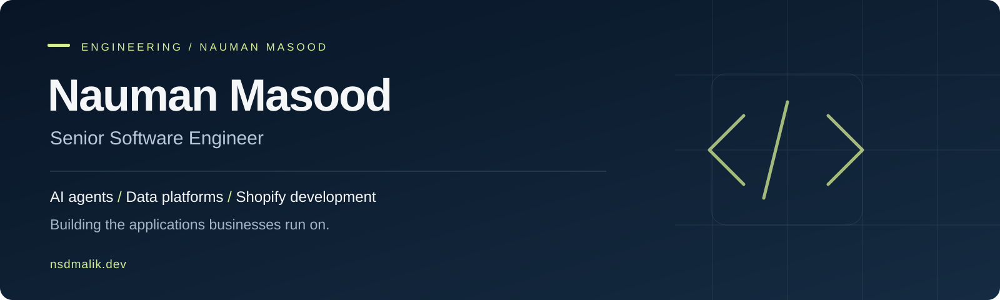

I'm Nauman, a **senior software engineer at Framar**. I build commerce interfaces and the applications behind them with React, TypeScript, Node.js and PostgreSQL. Shopify development is a big part of my work. Previously, I led a team of frontend engineers at **DOONAILS**.

[Website](https://nsdmalik.dev) · [LinkedIn](https://www.linkedin.com/in/nsdmalik/)

## A few projects

- **[Orderdesk](https://github.com/nsdmalik/commerce-orderdesk)**: a React ordering workspace with regional pricing and autosaved drafts. It explores what happens when two people edit the same order, prices change, or a save fails.
- **[Shopify Catalog Readiness](https://github.com/nsdmalik/shopify-catalog-readiness)**: a command-line tool that checks product exports for missing information, invalid identifiers and inconsistent variant data.
- **[Pipeline Reconciliation Kit](https://github.com/nsdmalik/pipeline-reconciliation-kit)**: a Python and SQLite example of importing records that arrive late, repeat or disappear from the source.

These projects use fictional data and are separate from my employer's code.

Also here: a small [HTML/CSS generation experiment](https://github.com/nsdmalik/design-to-web-agent-lab) and a [Python ordering demo](https://github.com/nsdmalik/b2b-ordering-portal).
